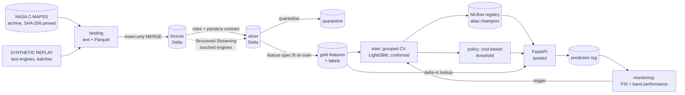

# C-MAPSS predictive maintenance

A production-style predictive-maintenance pipeline on the NASA C-MAPSS turbofan simulation data:
- a PySpark + Delta Lake medallion lakehouse (bronze → silver → gold);
- remaining-useful-life and failure-risk models;
- a cost-based maintenance policy;
- FastAPI serving, monitoring and retraining.

It runs locally with Docker and maps onto Databricks Jobs, Unity Catalog and MLflow (`databricks/`).

**Status:** all 8 phases complete. See [docs/phase_plan.md](docs/phase_plan.md). **Data:** NASA C-MAPSS, a
simulation; costs are assumptions, so every saving below is an estimate under them.

## Results

| | |
|---|---|
| Data pipeline | 265,256 cycles through bronze → silver → gold; 0 quarantined (clean benchmark); idempotent re-runs insert 0 rows |
| Features | 161 point-in-time features; per-condition normalisation lifts FD002/FD004 sensor–RUL correlation from about 0 to −0.69 |
| SYNTHETIC replay | 104,897 test rows in 20 batches, including deliberately late rows; incremental tables equal a full rebuild (0 mismatches) |
| RUL model (LightGBM) | RMSE 12.5 cycles vs capped RUL on the 707 official test engines (ridge 17.2, mean 44.7); 90% intervals cover 0.90 near failure |
| Failure within 30 cycles | PR-AUC 0.93 (logistic 0.86), calibrated with isotonic regression |
| Maintenance policy | 231 per engine vs 306 for the best fixed interval (**about 24% lower**) and 1,000 for run to failure |
| Serving and monitoring | FastAPI + MLflow in Docker Compose; PSI drift and band-stratified performance; retraining with champion/challenger |

Read next: [recommendations](reports/recommendations.md) · [model card](docs/model_card.md) ·
[methodology](docs/methodology.md) · [decisions](docs/decisions.md) · [limitations](docs/limitations.md) ·
[monitoring plan](docs/monitoring_plan.md) · [Databricks mapping](databricks/README.md).

## Architecture



## Decision supported

When to pull each engine for maintenance. Too late risks an in-service failure; too early wastes remaining useful
life and shop capacity. Costs, lead time and the comparison baselines are in
[docs/business_case.md](docs/business_case.md). The data is a NASA **simulation**; see
[data/README.md](data/README.md) for what that means for any real-world claim.

## How to run

Spark needs Linux, so all Spark steps run in the project container (D-002). Prerequisites: Docker Desktop and
[uv](https://docs.astral.sh/uv/).

```bash
docker compose build pipeline mlflow
```

```bash
uv run cmapss fetch
```

```bash
docker compose run --rm pipeline uv run cmapss bronze
```

```bash
docker compose run --rm pipeline uv run cmapss silver
```

```bash
docker compose run --rm pipeline uv run cmapss gold
```

```bash
docker compose run --rm pipeline uv run cmapss replay --batches 20
```

```bash
docker compose run --rm pipeline uv run cmapss train
```

```bash
docker compose run --rm pipeline uv run cmapss policy
```

```bash
docker compose run --rm pipeline uv run cmapss score
```

```bash
docker compose run --rm pipeline uv run cmapss monitor --retrain
```

```bash
docker compose up -d mlflow api
```

```bash
curl -s -X POST localhost:8000/predict -H "Content-Type: application/json" -d "{\"engine\": {\"dataset\": \"FD001\", \"split\": \"replay\", \"unit\": 7}}"
```

```bash
docker compose run --rm pipeline uv run pytest
```

- `fetch` downloads the archive from NASA, verifies the pinned checksum, extracts it and stages text and Parquet
  files in `data/landing/`. It runs on the host or in the container.
- `bronze` loads every landing file into Delta with an insert-only MERGE. Re-running it inserts nothing (D-004).
- `silver` types, validates and deduplicates bronze into silver. Rejected rows go to `silver/quarantine` with a
  reason. A pandera contract gates the result, and the step writes a data-quality report to
  [reports/data_quality/latest.md](reports/data_quality/latest.md).
- `gold` fits the feature spec on training engines (operating conditions, near-constant sensors, per-condition
  normalisation), builds 161 point-in-time features and the labels for every engine × cycle, checks
  point-in-time correctness on the full data and writes the evidence to [reports/features.md](reports/features.md).
- `replay` is a **SYNTHETIC REPLAY**: it re-delivers the real NASA test engines into `data/landing/replay/`, 25
  cycles per engine per batch, with 5 deliberately late rows per batch. Each batch goes through bronze, then a
  Structured Streaming step (`cmapss stream`) recomputes silver and gold for the engines it touched. The run
  checks that the result equals a full rebuild ([reports/replay.md](reports/replay.md)).
- `train` cross-validates the baselines and LightGBM models by engine, fits the calibrator and conformal intervals,
  scores the official NASA test engines once, logs everything to MLflow (`mlruns/`) and registers the bundle as
  `cmapss-maintenance` with alias `champion` when it improves. Results:
  [reports/model_comparison.md](reports/model_comparison.md).
- `policy` chooses the alert threshold by expected cost and compares the model rule with fixed-interval
  maintenance, run to failure and perfect information on full engine lives. It includes sensitivity to costs, the
  horizon and the lead time ([reports/maintenance_policy.md](reports/maintenance_policy.md)). Under the assumed
  costs the rule saves about 24% per engine against the best fixed interval (an estimate on simulated data).
- `score` writes the champion's predictions for the replayed engines into the prediction log. `monitor` checks
  each replay window for drift (PSI) and for performance by true-RUL band against the training baseline. With
  `--retrain`, it trains a challenger when a retraining signal fires; the challenger is promoted only if it improves
  the cross-validated metric ([reports/monitoring.md](reports/monitoring.md)).
- The API (`docker/Dockerfile.api`: slim, non-root, no Java) serves `/health`, `/model-info`, `/predict` and
  `/predict/batch` on port 8000. It loads the champion through the MLflow server (port 5000), reads gold features
  with delta-rs, logs JSON lines with request IDs, and appends every prediction to a Delta prediction log.
- Every threshold, path and cost assumption is in [configs/config.yaml](configs/config.yaml).

## Layout

| Path | Contents |
|---|---|
| `src/cmapss_pm/ingest/` | download and verification, landing staging, bronze Delta loader |
| `src/cmapss_pm/quality/` | silver rules and quarantine, pandera contract, data-quality report |
| `src/cmapss_pm/pipeline/` | incremental bronze → silver → gold stream, replay driver and report |
| `databricks/` | asset bundle (jobs) and mapping notes for Databricks |
| `src/cmapss_pm/serving/` | FastAPI app, champion and policy loading, gold feature lookup, prediction log |
| `src/cmapss_pm/monitoring/` | training baseline, PSI, band-stratified performance, retraining trigger, report |
| `src/cmapss_pm/policy/` | policy simulation, cross-fitted thresholds, sensitivity, report |
| `src/cmapss_pm/models/` | training data, grouped CV, baselines and LightGBM, conformal intervals, MLflow registry, report |
| `src/cmapss_pm/features/` | feature spec (fit on training engines), shared feature code, labels, gold build, evidence report |
| `docker/` | pipeline image (Java 17 + Spark 4 + Delta) and the slim API image |
| `tests/` | pytest; Spark tests run in the container and on CI |
| `docs/` | business case, methodology, decisions, model card, limitations, monitoring plan, lineage, phase plan |
