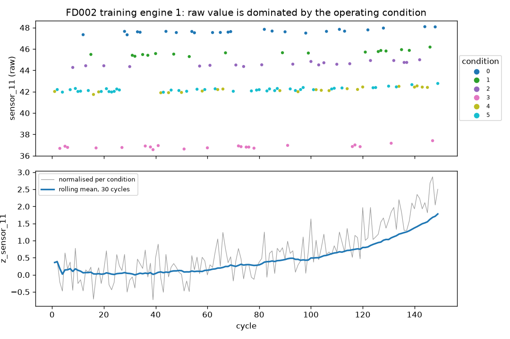
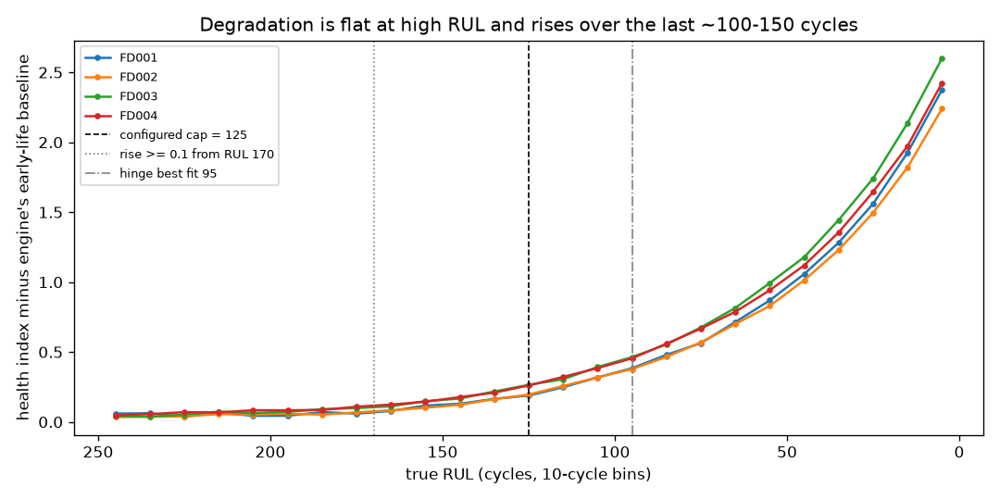

<!-- GENERATED by `cmapss gold` - do not edit by hand. -->
# Gold features and labels: evidence

Run gold-20261101T123619; feature spec version `1035ca0e0605` (fitted on 160,359 training cycles of
709 training engines; test engines never enter the fit). Code:
`src/cmapss_pm/features/`. Decisions: D-013 to D-017 in `docs/decisions.md`.

| item | value |
|---|---|
| silver cycles in | 265,256 |
| gold rows out | 265,256 |
| feature columns | 161 = cycle + 16 normalised sensors + 16 x 3 windows [5, 15, 30] x 3 |
| rolling statistics | mean, std (DataFrame API), slope (Spark SQL `regr_slope`) |
| kept sensors | 16: sensor_02, sensor_03, sensor_04, sensor_06, sensor_07, sensor_08, sensor_09, sensor_10, sensor_11, sensor_12, sensor_13, sensor_14, sensor_15, sensor_17, sensor_20, sensor_21 |
| dropped sensors | sensor_01, sensor_05, sensor_16, sensor_18, sensor_19 |
| operating conditions | 6 |
| RUL cap | 125 cycles |
| failure horizon N | 30 cycles (= maintenance lead time, config `business`) |

## 1. Near-constant sensors

A sensor is dropped when it has at most 2 distinct values within
every operating condition: then it carries the condition, not the engine's health. Counting within conditions
matters: across the whole fleet every sensor varies, because the six conditions shift all of them.

| sensor    |   distinct_within_condition_min |   distinct_within_condition_max |   within_condition_sd_max |   overall_sd | decision   |
|:----------|--------------------------------:|--------------------------------:|--------------------------:|-------------:|:-----------|
| sensor_01 |                               1 |                               1 |                     0.000 |       30.420 | drop       |
| sensor_02 |                             254 |                             350 |                     0.522 |       42.479 | keep       |
| sensor_03 |                            2743 |                            3695 |                     6.581 |      118.175 | keep       |
| sensor_04 |                            3370 |                            4924 |                     9.649 |      136.300 | keep       |
| sensor_05 |                               1 |                               1 |                     0.000 |        4.266 | drop       |
| sensor_06 |                               6 |                              17 |                     0.019 |        6.444 | keep       |
| sensor_07 |                             623 |                            1908 |                     2.751 |      174.134 | keep       |
| sensor_08 |                             119 |                             273 |                     0.269 |      142.427 | keep       |
| sensor_09 |                            4809 |                            9488 |                    20.519 |      374.657 | keep       |
| sensor_10 |                               3 |                               6 |                     0.005 |        0.142 | keep       |
| sensor_11 |                             146 |                             176 |                     0.291 |        3.426 | keep       |
| sensor_12 |                             596 |                            1815 |                     2.585 |      164.193 | keep       |
| sensor_13 |                             119 |                             291 |                     0.291 |      111.167 | keep       |
| sensor_14 |                            4464 |                            8525 |                    17.357 |       80.623 | keep       |
| sensor_15 |                            2824 |                            3477 |                     0.066 |        0.752 | keep       |
| sensor_16 |                               1 |                               2 |                     0.004 |        0.005 | drop       |
| sensor_17 |                              12 |                              14 |                     1.687 |       31.021 | keep       |
| sensor_18 |                               1 |                               1 |                     0.000 |      142.513 | drop       |
| sensor_19 |                               1 |                               1 |                     0.000 |        4.656 | drop       |
| sensor_20 |                              94 |                             171 |                     0.236 |       11.691 | keep       |
| sensor_21 |                            3396 |                            7548 |                     0.142 |        7.015 | keep       |

## 2. Operating conditions

k-means (k = 6) on the three settings, standardised; centroids in original units. Training rows
per condition and dataset; the furthest point of any split is 0.005
standardised units from its centroid, so the six conditions are discrete points with small jitter. FD001 and FD003
run only at sea level; FD002 and FD004 switch condition from cycle to cycle.

|   op_condition |   op_setting_1 |   op_setting_2 |   op_setting_3 |   FD001 |   FD002 |   FD003 |   FD004 |   max_distance_all_splits |
|---------------:|---------------:|---------------:|---------------:|--------:|--------:|--------:|--------:|--------------------------:|
|              0 |          0.000 |          0.000 |        100.000 |   20631 |    8044 |   24720 |    9238 |                     0.005 |
|              1 |         10.003 |          0.250 |        100.000 |       0 |    8096 |       0 |    9224 |                     0.004 |
|              2 |         20.003 |          0.701 |        100.000 |       0 |    8122 |       0 |    9091 |                     0.004 |
|              3 |         25.003 |          0.621 |         60.000 |       0 |    8002 |       0 |    9139 |                     0.004 |
|              4 |         35.003 |          0.841 |        100.000 |       0 |    8037 |       0 |    9162 |                     0.004 |
|              5 |         42.003 |          0.840 |        100.000 |       0 |   13458 |       0 |   15395 |                     0.004 |

## 3. Why per-condition normalisation (FD002, FD004)

Correlation with true RUL on training cycles, raw value versus value normalised by its condition's training mean
and standard deviation. Raw, the condition swamps the wear signal in FD002/FD004; normalised, the same sensors
correlate about as strongly as in the single-condition datasets. Sensors 07, 12, 15, 20 and 21 weaken or change
sign in FD004 (and FD003): those datasets have two fault modes (HPC and fan degradation), which move these sensors
in different directions, so the models must not assume one direction of wear per sensor. All four datasets:
`reports/tables/features_correlation_with_rul.csv`.

| sensor    |   FD002 raw |   FD002 normalised |   FD004 raw |   FD004 normalised |
|:----------|------------:|-------------------:|------------:|-------------------:|
| sensor_02 |       -0.00 |              -0.57 |       -0.00 |              -0.53 |
| sensor_03 |       -0.03 |              -0.55 |       -0.03 |              -0.58 |
| sensor_04 |       -0.04 |              -0.66 |       -0.05 |              -0.65 |
| sensor_06 |       -0.00 |              -0.32 |        0.00 |              -0.19 |
| sensor_07 |        0.00 |               0.42 |       -0.00 |              -0.29 |
| sensor_08 |        0.00 |              -0.35 |        0.00 |              -0.50 |
| sensor_09 |       -0.02 |              -0.35 |       -0.02 |              -0.52 |
| sensor_10 |        0.00 |               0.09 |       -0.01 |              -0.32 |
| sensor_11 |       -0.05 |              -0.69 |       -0.06 |              -0.69 |
| sensor_12 |        0.00 |               0.45 |       -0.00 |              -0.31 |
| sensor_13 |        0.01 |              -0.35 |        0.00 |              -0.50 |
| sensor_14 |       -0.04 |              -0.26 |       -0.08 |              -0.45 |
| sensor_15 |       -0.04 |              -0.65 |       -0.00 |              -0.01 |
| sensor_17 |       -0.03 |              -0.58 |       -0.03 |              -0.61 |
| sensor_20 |        0.01 |               0.42 |        0.00 |               0.04 |
| sensor_21 |        0.01 |               0.42 |        0.00 |               0.04 |

## 4. RUL cap (piecewise-linear target)

Health index = mean normalised value of sensor_02, sensor_03, sensor_04, sensor_11, sensor_17 (they rise with wear in all four
datasets), minus each engine's own mean over its first 30 cycles. Mean
by true-RUL bin:

|   rul_bin |   FD001 |   FD002 |   FD003 |   FD004 |
|----------:|--------:|--------:|--------:|--------:|
|         0 |    2.37 |    2.24 |    2.60 |    2.42 |
|        10 |    1.93 |    1.82 |    2.14 |    1.97 |
|        20 |    1.56 |    1.50 |    1.74 |    1.65 |
|        30 |    1.28 |    1.23 |    1.44 |    1.36 |
|        40 |    1.06 |    1.01 |    1.18 |    1.12 |
|        50 |    0.87 |    0.83 |    0.99 |    0.94 |
|        60 |    0.71 |    0.70 |    0.82 |    0.79 |
|        70 |    0.56 |    0.57 |    0.68 |    0.67 |
|        80 |    0.48 |    0.47 |    0.55 |    0.56 |
|        90 |    0.38 |    0.38 |    0.46 |    0.45 |
|       100 |    0.32 |    0.32 |    0.39 |    0.38 |
|       110 |    0.25 |    0.26 |    0.31 |    0.32 |
|       120 |    0.19 |    0.20 |    0.26 |    0.26 |
|       130 |    0.16 |    0.16 |    0.22 |    0.21 |
|       140 |    0.13 |    0.12 |    0.17 |    0.18 |
|       150 |    0.12 |    0.10 |    0.15 |    0.14 |
|       160 |    0.08 |    0.08 |    0.11 |    0.12 |
|       170 |    0.06 |    0.07 |    0.10 |    0.11 |
|       180 |    0.07 |    0.05 |    0.09 |    0.09 |
|       190 |    0.04 |    0.06 |    0.07 |    0.08 |
|       200 |    0.04 |    0.05 |    0.06 |    0.08 |
|       210 |    0.07 |    0.06 |    0.07 |    0.07 |
|       220 |    0.04 |    0.04 |    0.05 |    0.07 |
|       230 |    0.06 |    0.04 |    0.04 |    0.06 |
|       240 |    0.06 |    0.03 |    0.04 |    0.05 |

- The rise first exceeds 0.1 (within-condition standard deviations) at RUL 170 (pooled).
  Above that the index is flat within noise: the true RUL of a healthy engine cannot be read from the sensors.
- Least-squares hinge fit (flat until the cap, then linear): best cap 95 pooled (FD001 90, FD002 95, FD003 100, FD004 100). The hinge is biased
  low because wear accelerates (convex curve), so a straight line fits the steep end best.
- Training engine lives (cycles) by quantile: 0%: 128, 5%: 149, 50%: 207.

**Choice: cap = 125.** It lies between the hinge optimum and the visible onset, costs
7.6% more squared error than the best hinge on the pooled
data, sits below the 5% quantile of training engine life (so almost every engine has a flat-then-falling target),
and is a value widely used in C-MAPSS studies (125-130), which keeps RMSE comparable with them. Relative SSE
by cap (1.0 = best):

|   cap |   FD001 |   FD002 |   FD003 |   FD004 |   all |
|------:|--------:|--------:|--------:|--------:|------:|
|    80 |   1.020 |   1.027 |   1.050 |   1.052 | 1.037 |
|    90 |   1.000 |   1.001 |   1.008 |   1.013 | 1.005 |
|   100 |   1.012 |   1.005 |   1.000 |   1.000 | 1.001 |
|   110 |   1.046 |   1.030 |   1.017 |   1.008 | 1.020 |
|   120 |   1.098 |   1.071 |   1.055 |   1.032 | 1.054 |
|   125 |   1.129 |   1.096 |   1.079 |   1.048 | 1.076 |
|   130 |   1.162 |   1.123 |   1.107 |   1.067 | 1.100 |
|   140 |   1.234 |   1.183 |   1.169 |   1.112 | 1.156 |
|   150 |   1.310 |   1.248 |   1.238 |   1.164 | 1.217 |
|   175 |   1.493 |   1.411 |   1.427 |   1.307 | 1.378 |
|   200 |   1.647 |   1.551 |   1.615 |   1.452 | 1.530 |

## 5. Labels

`rul` = cycles left (training: last cycle minus cycle; test: the NASA RUL at the last cycle plus cycles to the
end). `rul_capped` = min(rul, 125). `fail_within_n` = 1 if rul <= 30. `is_last_cycle` marks
the test-set evaluation point.

| dataset   | split   |   engines |   rows |   fail_within_n_rate |   fail_within_n_rate_last_cycle |   share_at_cap |   rows_without_rul |
|:----------|:--------|----------:|-------:|---------------------:|--------------------------------:|---------------:|-------------------:|
| FD001     | test    |       100 |  13096 |                0.025 |                           0.250 |          0.614 |                  0 |
| FD001     | train   |       100 |  20631 |                0.150 |                           1.000 |          0.394 |                  0 |
| FD002     | test    |       259 |  33991 |                0.032 |                           0.236 |          0.609 |                  0 |
| FD002     | train   |       260 |  53759 |                0.150 |                           1.000 |          0.395 |                  0 |
| FD003     | test    |       100 |  16596 |                0.018 |                           0.200 |          0.691 |                  0 |
| FD003     | train   |       100 |  24720 |                0.125 |                           1.000 |          0.494 |                  0 |
| FD004     | test    |       248 |  41214 |                0.021 |                           0.214 |          0.716 |                  0 |
| FD004     | train   |       249 |  61249 |                0.126 |                           1.000 |          0.492 |                  0 |

## 6. Point-in-time correctness on the full data

Each engine's history cut at a random cycle t; features recomputed from the cut history only, compared with
gold at every cycle <= t. **PASSED**: 1,416 engines,
134,007 of 134,007 rows matched, 160 features, maximum
absolute difference 0, 0 null-pattern mismatches.

Figures: `figures/features_condition_normalisation.png`, `figures/features_rul_cap.png`.
